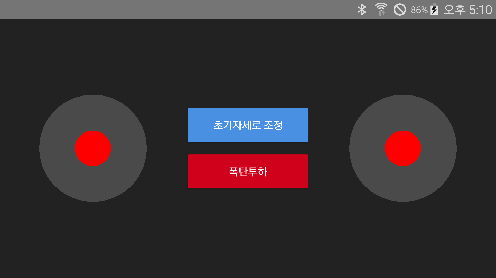

# 웹 기반 드론 시뮬레이션과 소켓 통신하는 안드로이드 앱

## 안드로이드 앱의 WebSocket 데이터 기반으로 드론의 움직임을 제어

## 작업 정보
- 안드로이드 스튜디오 래빗2버전 개발환경 사용
- 현재 기존 조이스틱에서 마우스+드래그 기반으로 드론 움직임 제어방식을 변경 OK. (https://github.com/kimilguk/WebBaseDroneSimulation)
- WebSocket 데이터로 드론 움직임 제어방식을 사용하는 안드로이드 앱은 제작 중. (https://github.com/kimilguk/SocketDroneSimulation)

## 원본 깃 허브 정보

- 안드로이드 스튜디오 래빗2버전에 내장된 Built-in Agent 사용
