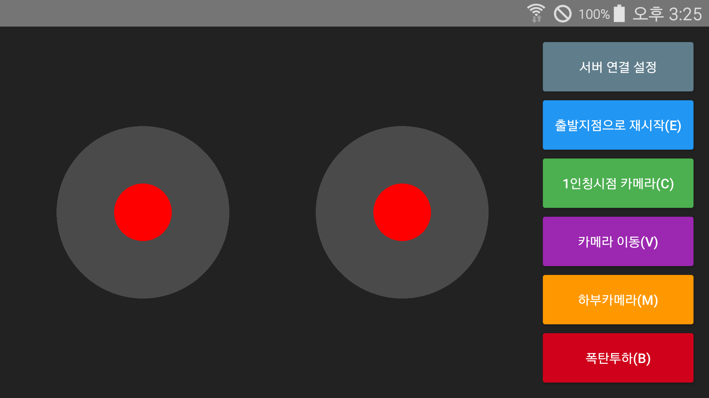

# 웹 기반 드론 시뮬레이션과 소켓 통신하는 안드로이드 앱

## 안드로이드 앱의 WebSocket 데이터 기반으로 드론의 움직임을 제어

## 동작 방식
- 1.앱 처음 실행 시: 서버 주소 입력 대화상자가 자동으로 열려 주소를 입력받고 연결합니다.
- 2.이후 실행 시: 마지막으로 입력한 주소로 자동 연결됩니다.
- 3.주소 변경 원할 시: 우측 상단의 서버 연결 설정 버튼을 누르면 언제든지 주소를 변경하여 재접속할 수 있습니다.

## 작업 정보
- 안드로이드 스튜디오 래빗2버전 개발환경 사용
- 현재 기존 조이스틱에서 마우스+드래그 기반으로 드론 움직임 제어방식을 변경 OK. (https://github.com/kimilguk/WebBaseDroneSimulation)
- WebSocket 데이터로 드론 움직임 제어방식을 사용하는 안드로이드 앱은 제작 OK. (https://github.com/kimilguk/SocketDroneSimulation)

## 원본 깃 허브 정보

- 안드로이드 스튜디오 래빗2버전에 내장된 Built-in Agent 사용(구글 제미나이)
